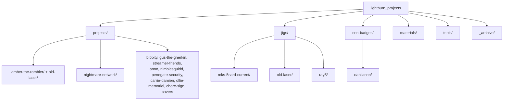

# LightBurn Projects

Laser and engraving project files for PurpleHax / custom streamer merch and gifts.
Organized by client/project. Each project folder holds its LightBurn source
(`.lbrn2`), generated gcode (`.gc`), and art together.

## Naming convention

`client_producttype_side_variant` in snake_case. Examples:
`amber_card_front.lbrn2`, `amber_card_back_dual_qr.gc`,
`nightmare_network_card_back.lbrn2`, `dahliacon_badge_large_front.lbrn2`.

## Layout

- `projects/` - one folder per client/product (source + gcode + art).
- `jigs/` - jig and template files, split by machine.
- `con-badges/` - convention badge sets.
- `materials/` - material/parameter test files (e.g. basswood photo test).
- `tools/` - `laser-send.sh`, push gcode to the networked laser over wifi.
- `_archive/` - backups, font tests, autosaves, orphaned art. Kept, not deleted.

## Lasers

| Laser | Role | Jig |
|-------|------|-----|
| MKS DLC32 (networked, ESP3D @ 192.168.1.119) | current production | permanent 5-card jig on the U-track (`jigs/mks-5card-current/`) |
| RAY5 | basswood ornaments/samples | `jigs/ray5/` |
| Old laser | legacy card work | `jigs/old-laser/` |

The MKS jig is permanently mounted and registered - cards drop into fixed
pockets, so work origin never changes. gcode runs from the laser's SD card;
push new jobs with `tools/laser-send.sh` (see its header for usage).

## Jig status (current MKS 5-card jig)

Verified by overlaying each card's toolpath on the jig pockets.

| Project | Status | Notes |
|---------|--------|-------|
| Amber The Rambler (front, back-dual-qr, back-variety) | VERIFIED | tiles 5-up into the pockets; back-dual-qr run confirmed on metal |
| Nightmare Network (front, back) | VERIFIED | tiles 5-up into the pockets |
| Gus The Gherkin | ONE-OFF | gift for a friend; not on the current jig; no regen needed |
| Streamer Friends (BADYEAR) | ONE-OFF | gift from last year; not on the current jig |
| Anon | NEEDS TEST | different/larger format; test on a blank before committing metal |
| Covers (prism/jade/shimmer/nyx) | GCODE-ONLY | `.lbrn2` source lost; gcode is the only surviving copy |
| bibbity, penegate, carrie-damien, ollie, chore-sign | OLD / MISC | not on the current 5-card jig |

Before committing real blanks for anything not marked VERIFIED, run it once on
scrap or paper in the jig and check registration.
